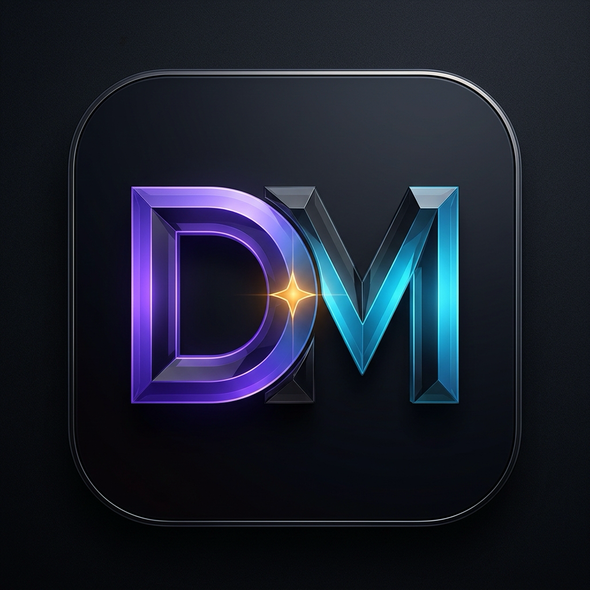

<div align="center">
  
  <h1>Design Master</h1>
  <p>A local desktop workbench for UI mockups, game HUDs, transparent assets, and coding-agent handoffs.</p>
</div>

[](https://github.com/jumpino27/design-master/releases/latest)
[](https://github.com/jumpino27/design-master/releases/latest)
[](https://github.com/jumpino27/design-master/releases/latest)
[](https://github.com/jumpino27/design-master/actions/workflows/release-installers.yml)
[](LICENSE)

Design Master combines a Next.js interface with a Rust/SQLite backend inside a Tauri desktop window. Projects, generated images, brand rules, and handoff prompts stay in a local storage directory. AI generation uses OpenRouter and requires your own API key.

## What it does

- Generate a UI mockup from a brief, brand rules, and reference screenshots.
- Plan multi-page flows around a shared visual reference.
- Extract reusable image assets into the same workspace tab.
- Work on game HUDs, interface components, landing pages, and app screens.
- Export DESIGN.md and implementation prompts for a coding agent.
- Organize projects, threads, outputs, and assets in local folders.

Includes Aetheris Chronicles and Jumpino View showcase projects. Generation quality and transparency depend on the selected model and output.

## Install

Download an installer from [GitHub Releases](https://github.com/jumpino27/design-master/releases/latest).

| Platform | Packages | Requirements |
| --- | --- | --- |
| macOS Apple Silicon | `.dmg`, `.app.tar.gz` | macOS 11 or later |
| Windows x64 | Setup `.exe`, portable `.zip` | WebView2, checked by the installer |
| Linux x64 | `.deb`, `.AppImage`, `.run` | WebKit2GTK 4.1 and GTK3 |

For Debian or Ubuntu, use `sudo apt install ./design-master_1.0.0_amd64.deb` so the package manager installs its dependencies. The `.run` installer installs under `~/.local` and requires those libraries to be present.

The macOS app is ad hoc signed and is not notarized. Windows packages are unsigned. OS security prompts may appear. Check downloads against the release's `SHA256SUMS.txt`.

## First launch

Choose a local project storage directory, add an OpenRouter API key, then select your text and image models. Verify model availability and current pricing in Settings before generating. Provider charges apply.

Keys can use the OS keyring or session memory. Local databases, generated project data, environment files, and build output are excluded from git. `.env.example` contains sample configuration.

## Build from source

Install Node.js 22 or later, pnpm 10, Rust stable, and the [Tauri prerequisites](https://v2.tauri.app/start/prerequisites/) for your OS.

```sh
pnpm install --frozen-lockfile
pnpm dev
```

To build the static frontend and native app, then package installers for the current OS:

```sh
pnpm build
```

Packages are written to `dist/installers/<platform>/`. Build Windows packages on Windows and Linux packages on Linux. The [release workflow](.github/workflows/release-installers.yml) builds macOS ARM64, Windows x64, and Linux x64 on native runners. It checks all seven packages and their checksums before publishing a version tag.

The Windows desktop executable includes the Rust backend in-process. The portable ZIP includes the static frontend alongside that executable.

## Updates

The application checks `jumpino27/design-master` on GitHub Releases. `DESIGN_MASTER_GITHUB_REPO` can override that repository. Update downloads must match the OS and architecture, GitHub's asset size, and its SHA-256 digest. Installation creates a SQLite backup under the data directory.

macOS installs an app bundle with rollback if replacement fails. Linux runs the user installer and checks its exit status. Windows launches the native setup program, which may require closing the running app. Restart after installation to run the new binary. A downloaded version does not count as the running version.

## Development checks

```sh
pnpm test:web
cargo test -p design-gen-server --locked
cargo fmt --all -- --check
```

The integration tests use a deterministic provider adapter and do not make paid generation calls.

## Project layout

- `web/`: Next.js interface and bundled showcase images.
- `crates/server/`: API, SQLite, provider requests, generation worker, exports, and updater.
- `src-tauri/`: Native application and OS bundle configuration.
- `prompts/v1/`: Generation and handoff templates.
- `scripts/`: Build, packaging, and installation scripts.

## Support and contributions

[Report an issue or propose a feature](https://github.com/jumpino27/design-master/issues). Funding links will appear here after the owner's payment profile is verified.

Licensed under [MIT](LICENSE).
